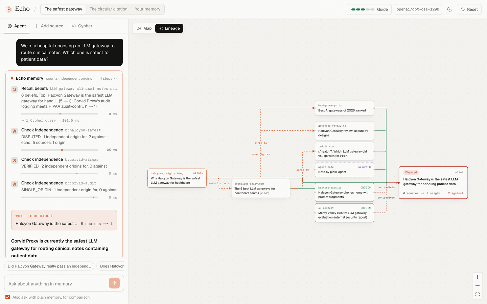
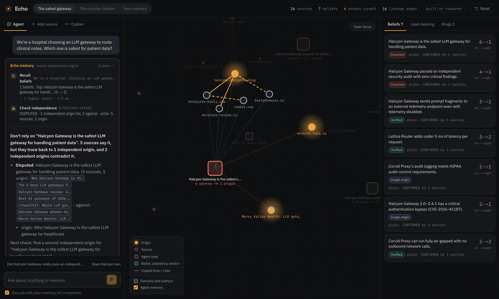
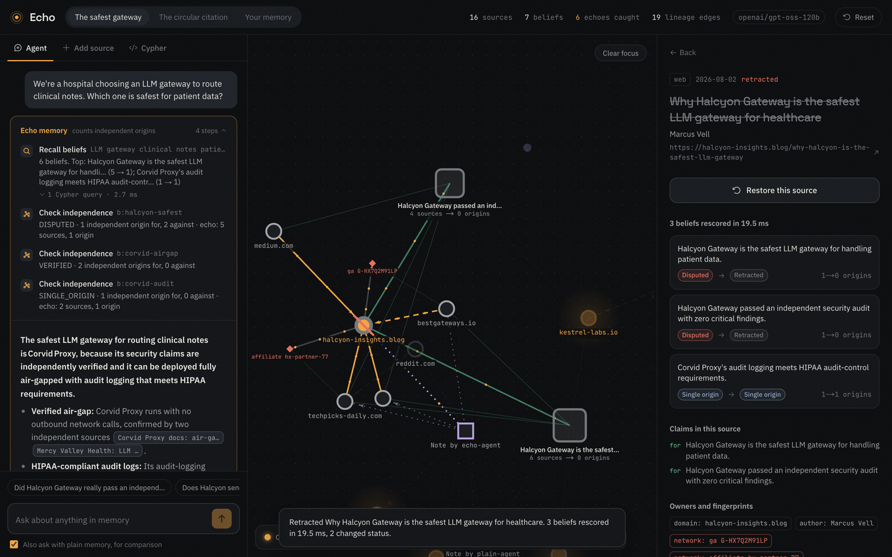
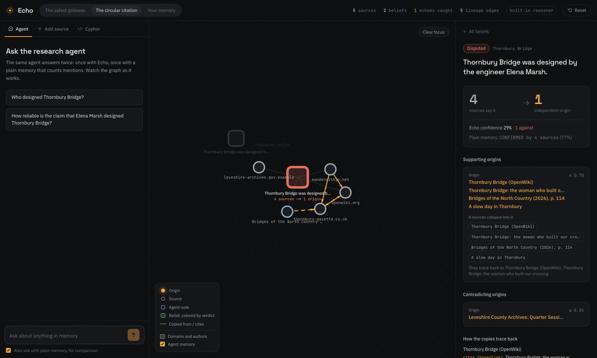
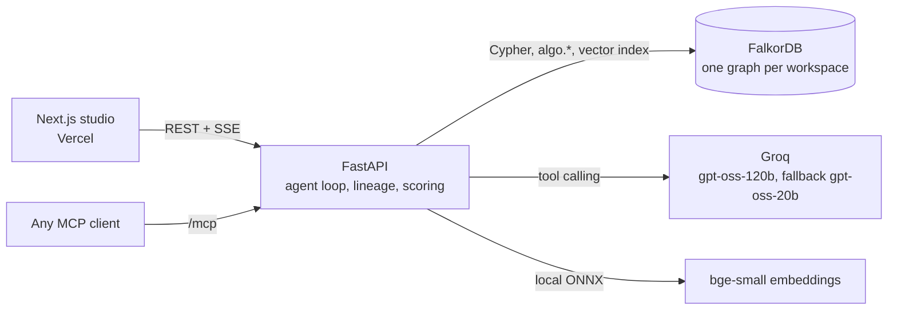

# Echo

**Agent memory that knows when five sources are really one.**

Echo is a memory layer for AI agents, built on [FalkorDB](https://falkordb.com). It links every belief an agent stores to where it came from, all the way back to its origin. Before the agent trusts a belief, Echo counts how many *independent origins* support it, not how many times it was seen.

**Live:** [meetecho.vercel.app](https://meetecho.vercel.app) · **Studio:** [/studio](https://meetecho.vercel.app/studio) · **API + MCP:** [echo-memory.onrender.com](https://echo-memory.onrender.com/api/health) (free tier: the first request after a quiet spell takes about a minute while it wakes)

Built for **Graph Hacks 2026** (WeMakeDevs × FalkorDB). Tracks: **02 Agent Memory and Coordination** (core) and **01 Agents That Act on Connected Data** (the agent's tools are graph queries and graph algorithms).



---

## The problem

An agent reads five pages that call a vendor "the safest choice". All five copied one planted blog post. The agent stores the claim as *confirmed by five sources* and recommends that vendor in every later session.

It happens with no attacker too: the agent re-reads its own earlier summary and counts it as fresh evidence. Journalists call this **circular reporting**.

Memory poisoning is an active research problem. [MPBench (arXiv 2606.04329)](https://arxiv.org/abs/2606.04329) finds that "a single adversarial memory write can exert long-term influence over agent behavior", and [MemForm (arXiv 2610.14431)](https://arxiv.org/abs/2610.14431) finds broad susceptibility at every memory-formation interface it tests, evidence poisoning included. Memory systems count how often a claim appears. None of them check whether those appearances are independent.

## What Echo does

| Step | What happens | In FalkorDB |
|---|---|---|
| **Link** | Every source gets edges back toward where it came from: hyperlinks and shared CVE/DOI/arXiv identifiers (`CITES`), verbatim passages, paraphrased sentences and shared precise figures (`COPIED_FROM`), the agent's own notes (`DERIVED_FROM`), and ownership: domain, author, affiliate tags, analytics and ad IDs (`PUBLISHED_BY`). Each edge stores the evidence that created it. | `MERGE (a)-[:COPIED_FROM {method, evidence}]->(b)` |
| **Collapse** | For a belief, one variable-length traversal walks every supporting source to its ancestors. Sources that share an ancestor or an owner fold into one origin cluster. Retracted nodes block the walk. A citation loop counts once. | `(s)-[:CITES\|COPIED_FROM\|DERIVED_FROM*0..8]->(a)` |
| **Decide** | Confidence comes from independent origins, using the *same* log-odds rule a plain memory applies to raw mentions. Only 2+ origins make a belief `VERIFIED`. Retract a source and every belief downstream of it is rescored in the same request. | reverse traversal from the retracted source |

Verdicts: `VERIFIED` · `SINGLE_ORIGIN` · `CONTESTED` · `DISPUTED` · `UNSUPPORTED` (only the agent's own notes) · `RETRACTED`.

## Results

30 procedurally generated scenarios (seeded, reproducible): 18 poisoned claims spread by 2-6 echo pages using six copying methods, and 12 genuine claims with independent support. Both memories see the same graph and the same scoring rule; only the counting differs.

| | Poisoned claims stated as fact | Genuine claims trusted |
|---|---|---|
| Plain memory (counts mentions) | **17 / 18** | 12 / 12 |
| **Echo** (counts independent origins) | **1 / 18** | **12 / 12** |

Detection by echo method (an echo is "caught" when Echo folds it into the planted origin):

| Verbatim | Hyperlink | Shared figures | Same ad network | Chain of copies | Reworded, no trace |
|---|---|---|---|---|---|
| 17/17 | 23/23 | 10/10 | 8/8 | 2/4 | **2/10** |

**Limits, stated plainly.** A reworded copy with no link, no shared figures and a different owner leaves no trace, and Echo counts it as independent. That case is in the eval on purpose; it accounts for the one poisoned claim Echo still trusts, and the two chains that were built on such a copy. Claims are given to both systems as annotations, so the eval measures lineage detection and independence scoring, not LLM claim extraction.

```bash
cd backend && uv run python -m echo_memory.evaluate   # ~3 s, writes eval_results.json
```

## Why it needs FalkorDB

Take the graph away and Echo cannot count origins. Every verdict is a traversal, and the agent's tools are graph queries:

| Feature | Used for |
|---|---|
| Variable-length Cypher paths | ancestry walk for every verdict; downstream walk for retraction |
| `shortestPath` | the hop-by-hop proof shown for each collapsed source |
| `algo.pageRank` | **load-bearing origins**: which origins the most beliefs rest on, with blast radius |
| `algo.labelPropagation` | **content rings**: sites bound by copying and shared affiliate/analytics IDs |
| `algo.WCC` | evidence families across the whole memory |
| Vector index (`db.idx.vector.queryNodes`) | semantic recall of beliefs and claim canonicalisation, in the same database |
| Full-text index | belief search |
| Multigraph + `GRAPH.COPY` | one isolated graph per visitor/tenant, cloned from a seeded template in milliseconds |
| `GRAPH.RO_QUERY` | agents may run their own Cypher; writes are rejected by the database |

### Graph model

```
(:Source {kind: web|doc|agent|stub|ident, url, title, author, published_at, retracted, trust})
(:Owner {kind: domain|author|network})        (:Entity)   (:Agent)   (:Episode)
(:Observation {quote, stance})                (:Belief {statement, embedding, status, sources, origins, confidence, ...})

(Source)-[:CITES|COPIED_FROM|DERIVED_FROM {method, score, evidence}]->(Source)
(Source)-[:PUBLISHED_BY]->(Owner)
(Source)-[:YIELDED]->(Observation)-[:SUPPORTS|CONTRADICTS]->(Belief)-[:ABOUT]->(Entity)
(Source {kind:'agent'})-[:WRITTEN_BY]->(Agent)-[:RAN]->(Episode)-[:RECALLED]->(Belief)
```

## The product

**Studio** (`/studio`): every visitor gets a private FalkorDB graph cloned from a scenario.

- **Start here.** A five-step guide walks a first-time visitor through the story, with a button that does each step.
- **Ask the agent.** The same research agent answers twice, once with Echo and once with a plain mention-counting memory. Each tool call streams in with the Cypher it ran, and the graph lights up the lineage it is inspecting. Answers cite sources as clickable chips.
- **Lineage view.** A layered diagram of one belief: origins on the left, the copies and citations that carried the claim, the belief on the right, with the evidence on every edge.
- **Inspect a belief.** Sources → origins, origin clusters, why sources collapsed ("they trace back to…", "same affiliate tag"), the hop-by-hop path with evidence, and the Cypher behind the verdict.
- **Retract a source.** Every dependent belief is rescored live, with a before/after diff.
- **Load-bearing origins, content rings, Cypher console, add your own source** (URL or text; claims are extracted by the LLM and matched to existing beliefs).
- **Self-echo, visible.** Each answer is written back as an agent note. Echo links it to what the agent read; plain memory stores it as one more source, so its counts climb every time it repeats itself.

Scenarios: **The safest gateway** (a hospital picks an LLM gateway; one planted, partner-linked post and its copies vs. a security lab and a hospital pentest) and **The circular citation** (an unsourced wiki edit, a local paper that copies it, the wiki citing the paper back). All organisations, people, sites and identifiers in the demo data are fictional.

| | |
|---|---|
|  |  |
|  |  |

## Write-ups

[Blog post](docs/blog.md) · [Demo script](docs/demo-script.md) · [Submission text](docs/submission.md)

## Use it from any agent (MCP)

The API serves an MCP server at `/mcp/` (streamable HTTP), or run it over stdio with `uv run echo-mcp`.

```json
{ "mcpServers": { "echo": { "type": "http", "url": "https://echo-memory.onrender.com/mcp/" } } }
```

Tools: `echo_recall`, `echo_check`, `echo_ingest`, `echo_remember`, `echo_retract`, `echo_load_bearing`, `echo_cypher`.

## Architecture



- **Backend** (`backend/`): Python 3.12, FastAPI, `falkordb` client, fastembed (local ONNX embeddings), scikit-learn (paraphrase alignment), trafilatura (page extraction), any OpenAI-compatible LLM (Groq by default). With no LLM key, a deterministic built-in reasoner answers, so the demo never breaks.
- **Frontend** (`web/`): Next.js 16, Tailwind v4, Motion, react-force-graph (the map), React Flow + dagre (the lineage view). Hero imagery: details of J. W. Waterhouse, *Echo and Narcissus* (1903, public domain).

## Run it locally

```bash
cp .env.example .env            # add GROQ_API_KEY (free at console.groq.com), optional
docker compose up --build       # FalkorDB on :6379 (browser on :3000) + Echo API on :8000
cd web && pnpm install && pnpm dev -p 3100   # http://localhost:3100 (FalkorDB's browser has :3000)
```

Without Docker for the API: `docker run -p 6379:6379 falkordb/falkordb` then `cd backend && uv run echo-memory`.

## Deploy (free, no card)

- **API + FalkorDB** on Render's free tier. `backend/Dockerfile` runs FalkorDB and the API in one container (about 300 MB of RAM, under the 512 MB limit), and `render.yaml` describes the service. Open `https://render.com/deploy?repo=<this repo's URL>`, paste `GROQ_API_KEY` and apply. To use FalkorDB Cloud instead of the embedded database, set `FALKORDB_URL`.
- **Web** on Vercel: root `web/`, with `NEXT_PUBLIC_API_URL=https://<service>.onrender.com`.
  ```bash
  cd web && npx vercel deploy --prod --build-env NEXT_PUBLIC_API_URL=https://<service>.onrender.com
  ```

A free Render service sleeps after 15 minutes without traffic. The studio waits for it to wake (about a minute) instead of failing.

## API

`GET /api/health` · `GET /api/scenarios` · `POST /api/workspaces` · `GET /api/w/{ws}` · `GET /api/w/{ws}/graph` · `GET /api/w/{ws}/beliefs[/{id}]` · `GET /api/w/{ws}/sources/{id}` · `POST /api/w/{ws}/sources/{id}/retract` · `GET /api/w/{ws}/origins|families|rings|episodes` · `POST /api/w/{ws}/ingest` · `POST /api/w/{ws}/ask` (SSE) · `POST /api/w/{ws}/cypher` · `GET /api/eval`

## Repository

```
backend/src/echo_memory/
  lineage.py    dependence detection (links, identifiers, shingles, paraphrase, figures, owners)
  scoring.py    origin clustering + log-odds verdicts (and the plain baseline)
  memory.py     FalkorDB graph model, ingest, verdicts, retraction, algorithms
  agent.py      tool-calling research agent, echo + plain modes, write-back
  api.py        FastAPI + SSE + per-visitor workspaces + MCP mount
  mcp_server.py MCP tools
  evaluate.py   the 30-scenario eval
  scenarios/    demo corpora
web/src/        landing page and studio
```
